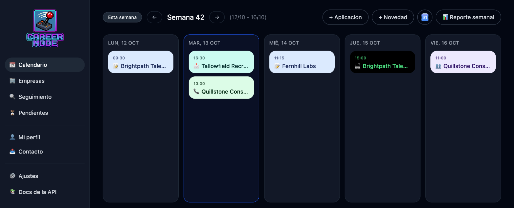
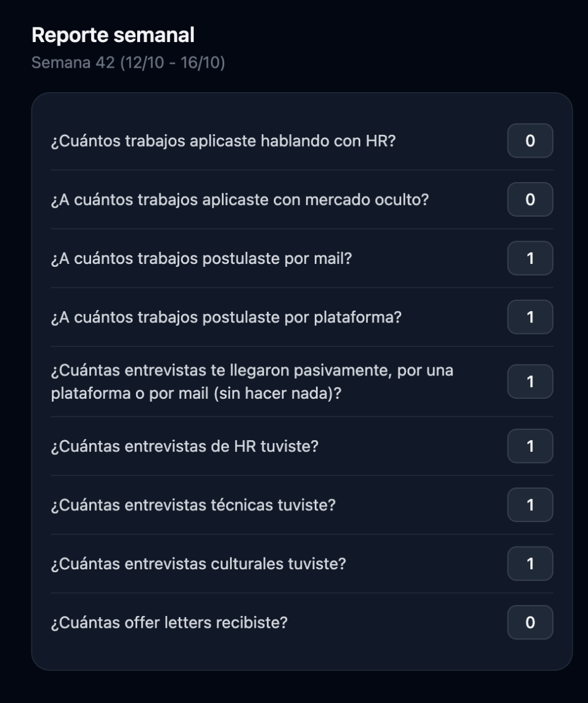
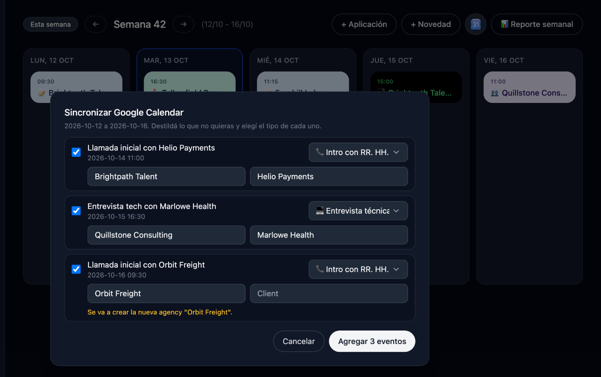
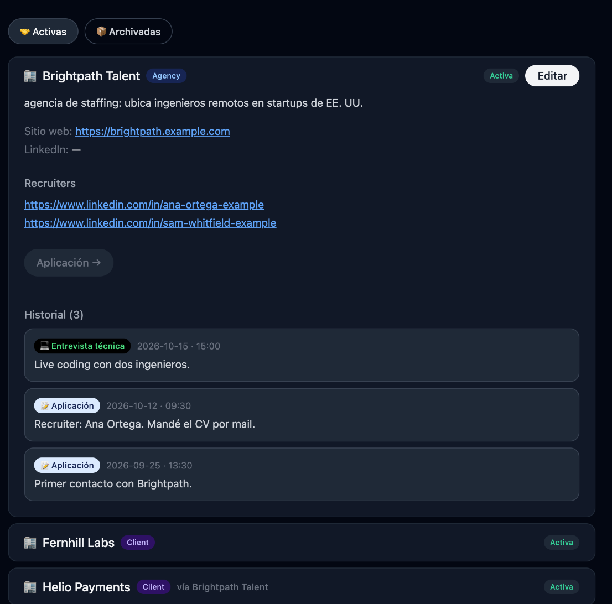
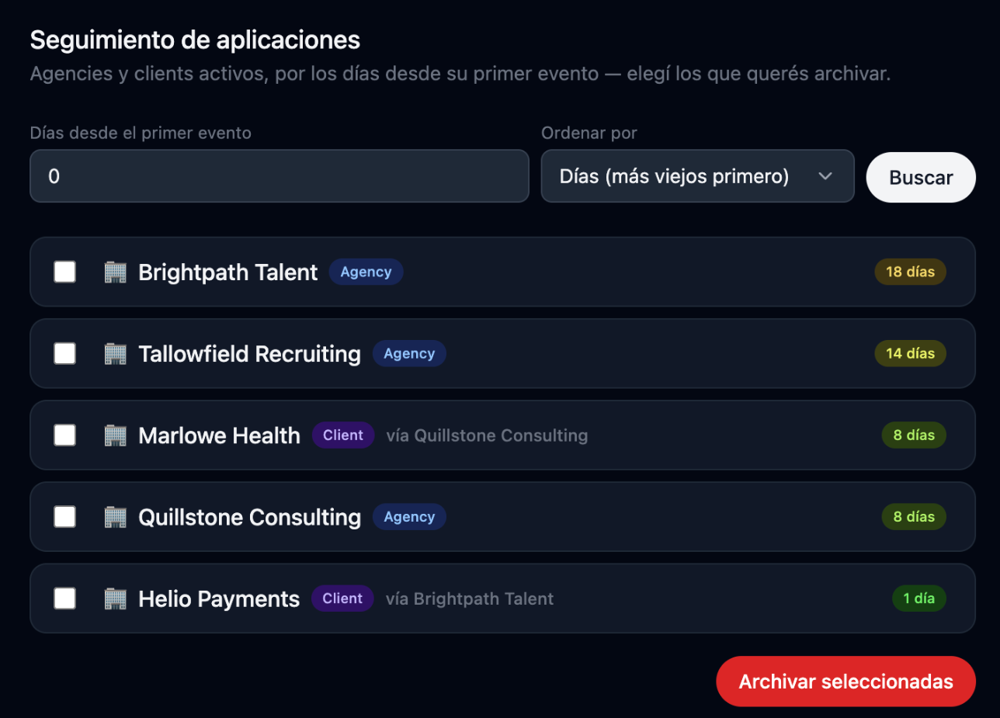
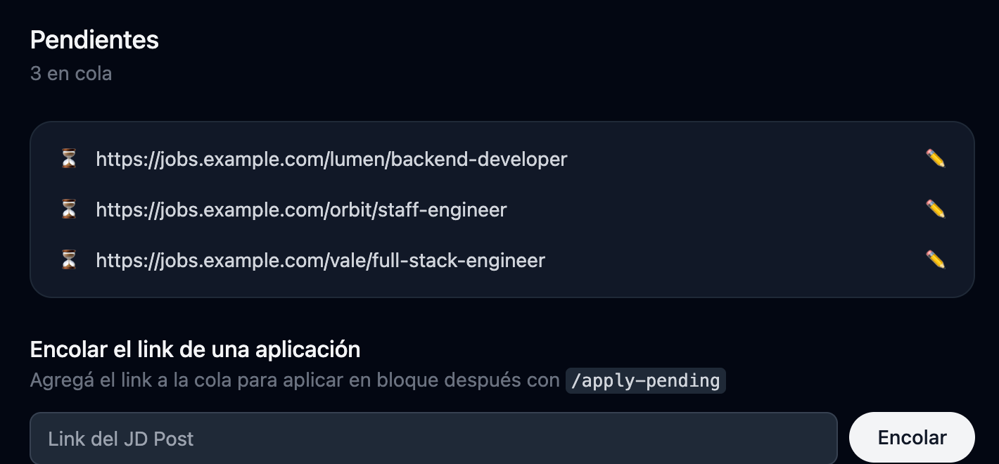
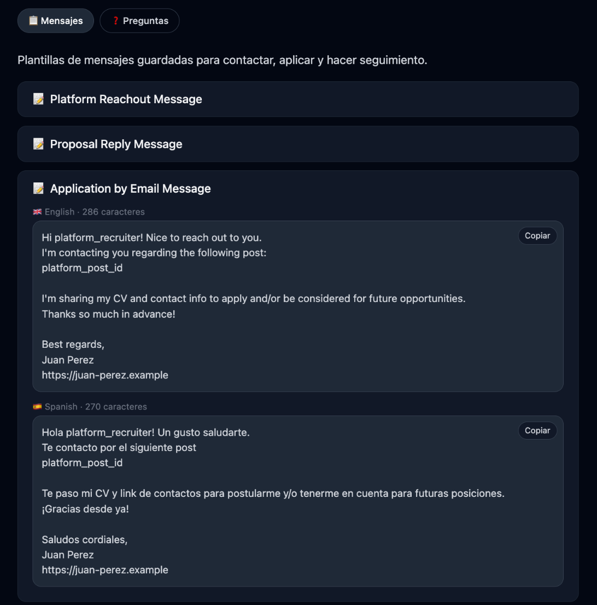
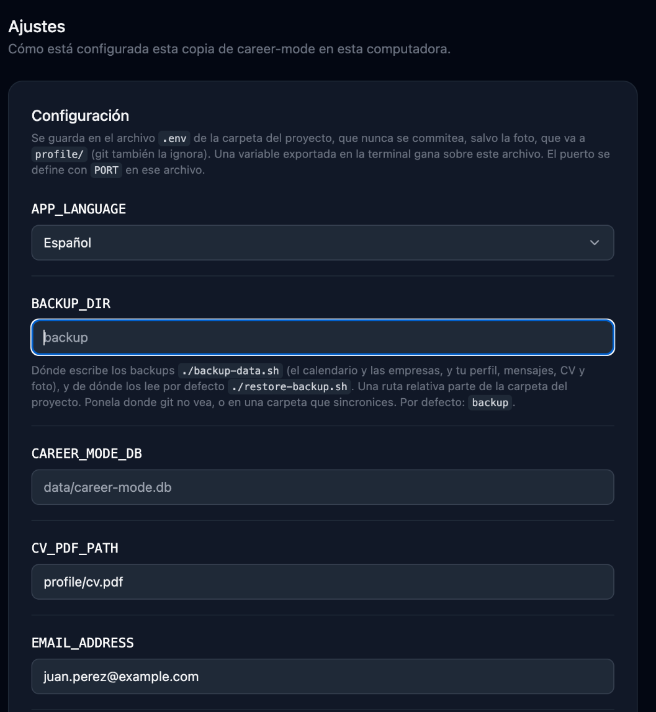

<h1 align="center"></h1>

Un seguidor de búsqueda laboral privado y para una sola persona, que corre en tu computadora: un archivo SQLite, sin cuentas, sin nube.

[English](README.md)

## Stack

- **FastAPI** sirve la app y una API JSON (docs en `/docs`)
- **SQLite** con SQLAlchemy, Pydantic y Alembic
- HTML/CSS/JS plano en `public/`, con Tailwind desde su CDN: sin bundler, sin framework

## Empezar rápido

1. **Haz un fork** en GitHub (`gh repo fork --clone --remote`) y entra en la carpeta.
2. Ábrela en **Claude Code** y ejecuta `/setup`: inicia la app y te pide el CV, los mensajes, la foto y el calendario, una pregunta a la vez (cada una se puede omitir).
3. Abre <http://localhost:8333>.

Nada personal sale de tu computadora: git ignora `profile/`, `data/`, `backup/` y `.env`. Sin Claude Code la app igual funciona como seguidor.

```bash
./run-local.sh   # la inicia en segundo plano (Python 3.10+)
./stop.sh        # la detiene
```

## Features

### Calendario
Registra cada aplicación en una vista semanal, desde el primer mensaje hasta la oferta o el rechazo: aplicaciones, mensajes de recruiters, entrevistas, notas. Agrega o edita eventos desde la misma página. El **Weekly Report** cuenta lo que enviaste esa semana (por email o por plataforma) y lo que avanzó. **Sync Google Calendar** trae tus entrevistas de HR, técnicas y de cultura desde tu propio calendario.

<p align="center">
  
</p>

Revisa tu Reporte Semanal 📊
<p align="center">
  
</p>

Sincroniza tu Google Calendar 📅
<p align="center">
  
</p>

### Empresas
Todas las agencias y clientes con los que trataste, en un solo lugar: sitio web, LinkedIn, los recruiters con los que hablaste y cada aplicación con su link y sus notas. Una empresa se archiva sola cuando un proceso se cierra (rechazo, oferta, en pausa) y se reactiva cuando pasa algo nuevo.

<p align="center">
  
</p>

### Seguimiento
Muestra cuántos días lleva abierta cada aplicación, contados desde tu última aplicación, para ver cuáles necesitan un empujón. Ordena por más antiguas, más nuevas o por nombre.

<p align="center">
  
</p>

### Pendientes
Pega los links de los trabajos a los que quieres aplicar y déjalos en cola. Después ejecuta `/apply-pending`: lee cada JD Post, verifica que sea reciente y que encaje con tu perfil, aplica por email o por formulario y registra la aplicación por ti.

<p align="center">
  
</p>

### Contacto
Los mensajes que más envías (aplicación, cover letter, respuesta de rechazo y otros), en los idiomas en que escribes. Copia uno con un clic; los skills usan los mismos textos cuando aplican por ti.

<p align="center">
  
</p>

### Ajustes
Todo lo que necesitan la app y los skills, en una sola lista: idioma (English o español), cuenta de correo, CV, Google Calendar y foto. Las claves y contraseñas quedan ocultas hasta que haces clic en el ojo.

<p align="center">
  
</p>

## Mi perfil

Todo lo personal vive en `profile/` (git lo ignora, salvo el README y los archivos `*.example.*`): `profile.md` (lo que leen los skills) y `outreach.md` (tus mensajes). `/read-cv` completa el perfil desde tu CV; mira [profile/README.md](profile/README.md).

## Skills

En `.claude/skills/`, cada uno con su README:

- `setup`: deja funcionando un fork nuevo, paso a paso
- `read-cv`: completa tu perfil desde tu CV
- `apply-pending`: aplica a los links en cola, eligiendo email o formulario
- `apply-email`: envía una aplicación por email, con el CV adjunto
- `apply-site`: completa el formulario de postulación de una empresa
- `reply-recruiter`: responde a un recruiter que escribió primero
- `sync-aiapply`: registra lo que AIApply.io recibió de las empresas y manda a la papelera sus avisos "Not this time"
- `reply-rejected`: agradece a las empresas que te rechazaron, desde tu Gmail, archiva el mail y registra el rechazo
- `check-email`: ordena tu Gmail reciente y ejecuta los skills que se ocupan de cada cosa
- `submit-profile`: completa portales de candidatos con tu perfil
- `write-daily-post`: escribe el post diario y su imagen
- `commit`: commitea tus cambios en la rama actual, corto y a tu nombre

## Backups

```bash
./backup-data.sh                    # calendario, empresas, perfil, CV, foto, profile.pdf
./restore-backup.sh                 # carga el backup de vuelta
./restore-backup.sh <carpeta> --replace
```

Van a `backup/`, que git ignora. También guarda una copia de tu `.env` (`backup/env/env`, legible solo por ti) con tus claves y contraseñas: mantén esa carpeta privada, sin sincronizar ni compartir.

## Tests

```bash
./run-tests.sh   # pytest para el servidor, node --test para el front end
```

Usan solo datos inventados, y `tests/test_no_personal_data.py` verifica que nada de tu `profile/` termine en un archivo que git rastrea.

## Licencia

[MIT](LICENSE).
