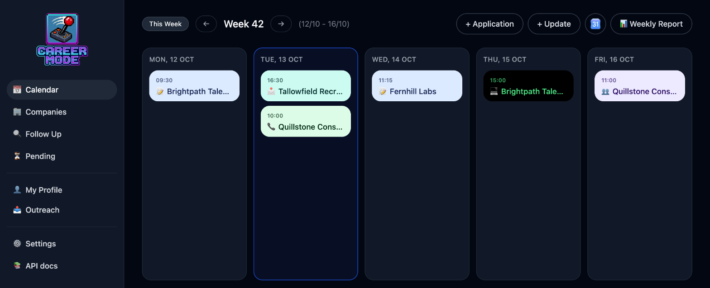
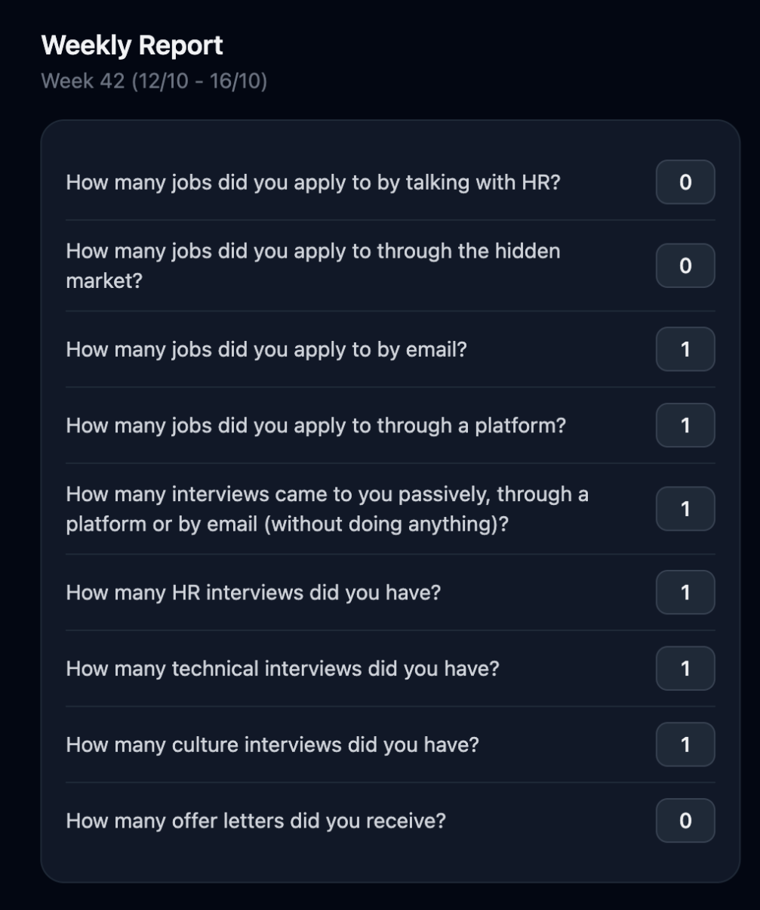
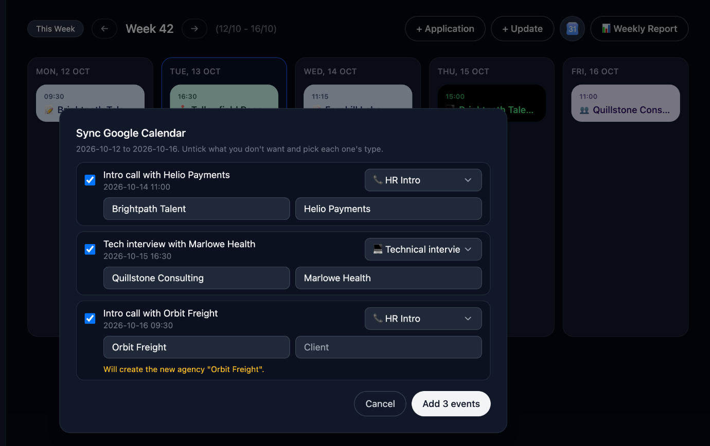
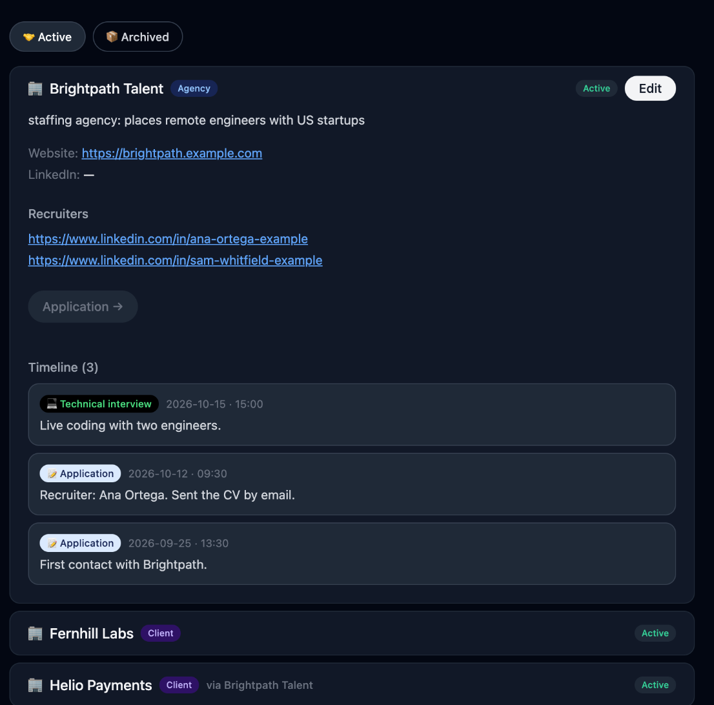
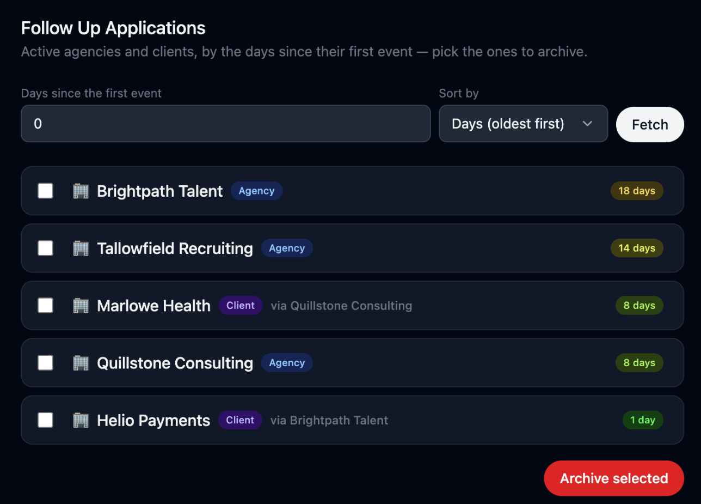
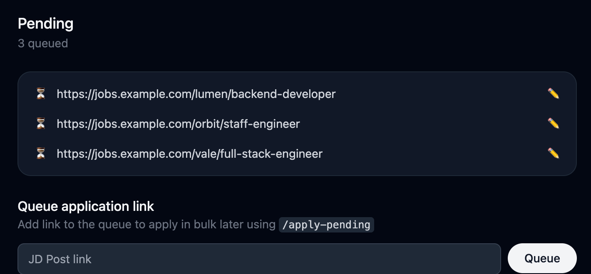
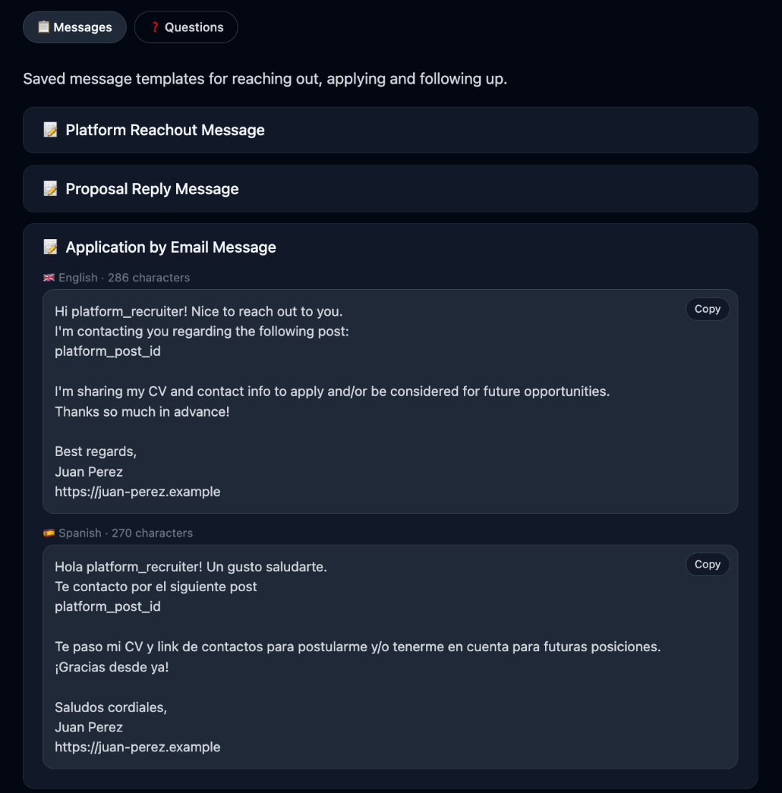
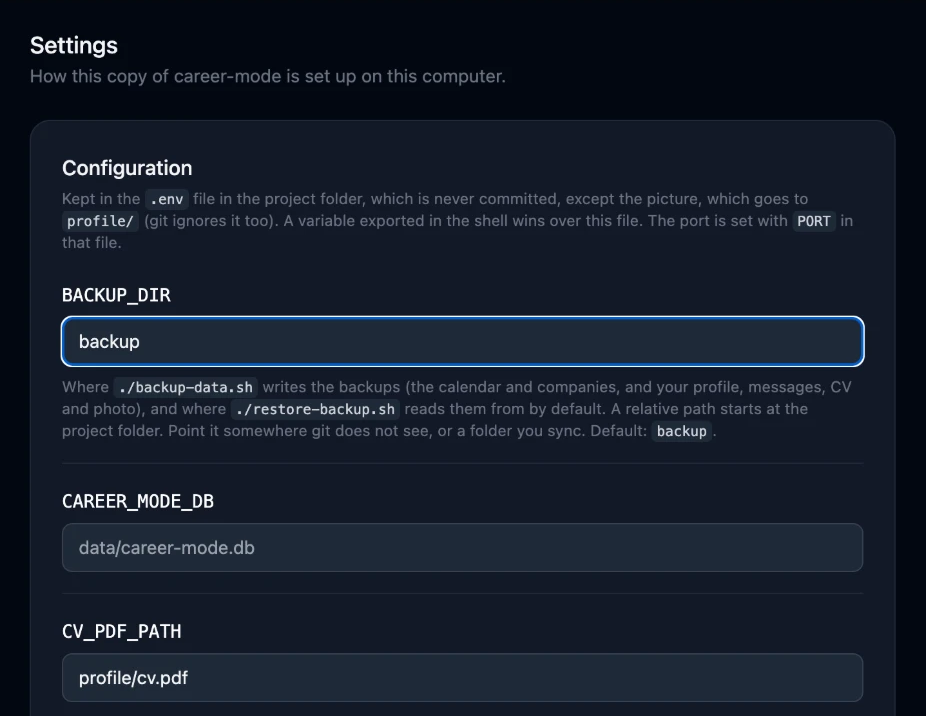

<h1 align="center"></h1>

A private, single-user job search tracker that runs on your own computer: one SQLite file, no accounts, no cloud.

[Español](README.es.md)

## Stack

- **FastAPI** serves the app and a JSON API (docs at `/docs`)
- **SQLite** with SQLAlchemy, Pydantic and Alembic
- Plain HTML/CSS/JS in `public/`, with Tailwind from its CDN: no bundler, no framework

## Quick start

1. **Fork it** on GitHub (`gh repo fork --clone --remote`) and go into the folder.
2. Open it in **Claude Code** and run `/setup`: it starts the app and asks for your CV, messages, picture and calendar, one question at a time (each skippable).
3. Open <http://localhost:8333>.

Nothing personal leaves your computer: git ignores `profile/`, `data/`, `backup/` and `.env`. Without Claude Code the app still runs as a tracker.

```bash
./run-local.sh   # starts it in the background (Python 3.10+)
./stop.sh        # stops it
```

## Features

### Calendar
Log every job application in a week-view calendar, from the first message to the offer or the rejection: applications, recruiter messages, interviews, notes. Add or edit events from the same page. The **Weekly Report** counts what you sent that week (by mail or by platform) and what moved forward. **Sync Google Calendar** brings your HR, technical and culture interviews in from your own calendar.

<p align="center">
  
</p>

Check your Weekly Report 📊
<p align="center">
  
</p>

Sync your Google Calendar 📅
<p align="center">
  
</p>

### Companies
Every agency and client you have dealt with, in one place: website, LinkedIn, the recruiters you talked to, and each application with its link and notes. A company is archived by itself when a process closes (rejection, offer, on hold) and wakes up when something new happens.

<p align="center">
  
</p>

### Follow Up
Shows how many days each application has been open, counted from your latest application, so you can see which ones need a nudge. Sort by oldest, newest or name.

<p align="center">
  
</p>

### Pending
Paste the links of the jobs you want to apply to and leave them queued. Then run `/apply-pending`: it reads each JD Post, checks that it is recent and that it fits your profile, applies by email or form, and logs the application for you.

<p align="center">
  
</p>

### Outreach
The messages you send most (application, cover letter, rejection reply, and so on), in the languages you write in. Copy one with a click; the skills use the same texts when they apply for you.

<p align="center">
  
</p>

### Settings
Everything the app and the skills need, in one list: language (English or Spanish), email account, CV, Google Calendar and picture. Keys and passwords are hidden until you click the eye.

<p align="center">
  
</p>

## Your profile

Everything personal lives in `profile/` (git ignores it, except the README and the `*.example.*` files): `profile.md` (what the skills read) and `outreach.md` (your messages). `/read-cv` fills the profile from your CV; see [profile/README.md](profile/README.md).

## Skills

In `.claude/skills/`, each with its own README:

- `setup`: gets a fresh fork working, step by step
- `read-cv`: fills your profile from your CV
- `apply-pending`: applies to the queued links, choosing email or form
- `apply-email`: sends an application by email, CV attached
- `apply-site`: fills a company's application form
- `reply-recruiter`: answers a recruiter who wrote first
- `submit-profile`: fills candidate portals from your profile
- `write-daily-post`: writes the daily post and its image
- `commit`: commits your changes on the current branch, short and under your name

## Backups

```bash
./backup-data.sh                    # calendar, companies, profile, CV, photo, profile.pdf
./restore-backup.sh                 # load the backup back
./restore-backup.sh <folder> --replace
```

They go to `backup/`, which git ignores. It also keeps one copy of your `.env` (`backup/env/env`, readable only by you) with your keys and passwords: keep that folder private, not synced or shared.

## Tests

```bash
./run-tests.sh   # pytest for the server, node --test for the front end
```

They use invented data only, and `tests/test_no_personal_data.py` checks that nothing from your `profile/` ends up in a file git tracks.

## License

[MIT](LICENSE).
